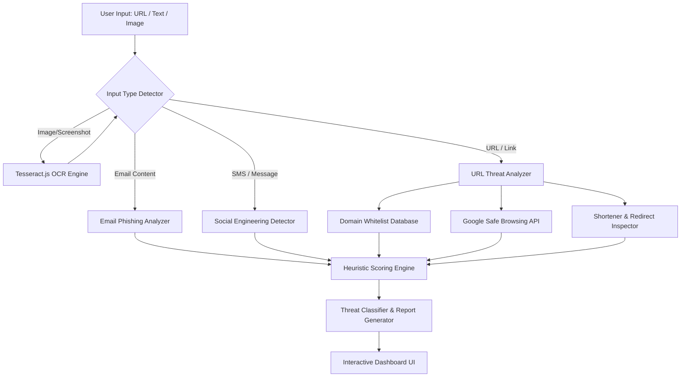

# 🛡️ SAFE-NET AI (SAFETEMP)
### Advanced Phishing Detection & Cyber Fraud Prevention System

[](https://nextjs.org/)
[](https://www.typescriptlang.org/)
[](https://react.dev/)
[](https://firebase.google.com/)
[](https://tesseract.projectnaptha.com/)
[](LICENSE)

---

## 📌 Overview

**SAFE-NET AI** is an intelligent, real-time cybersecurity defense and fraud detection platform. It protects users and enterprise organizations against modern cyber threats, including phishing campaigns, credential harvesting, business email compromise (BEC), deceptive URLs, smishing (SMS phishing), and fraudulent payment requests.

Combining machine learning heuristics, the **Google Safe Browsing API**, an extensive domain whitelist database, and client-side **OCR (Optical Character Recognition)**, SAFE-NET provides multi-layered vulnerability detection with an intuitive cyber-defense dashboard.

---

## ✨ Key Features

### 🔍 1. Multi-Vector Threat Analysis
* **URL & Domain Scanner**:
  * Real-time querying against the **Google Safe Browsing API**.
  * Detection of suspicious URL shorteners (e.g., `bit.ly`, `tinyurl`, `is.gd`) and redirect chains.
  * Domain typosquatting, homoglyph attack detection, and spoofed brand identification.
  * SSL/TLS certificate mismatch and insecure protocol warnings (`http://`).
* **Email Phishing Inspector**:
  * Sender spoofing and domain anomaly checks.
  * Heuristic analysis for urgent language, financial pressure, and social engineering patterns.
  * Verification indicators for DMARC, SPF, and lookalike executive addresses.
* **SMS & Message Smishing Detection**:
  * Linguistic pattern recognition for fraudulent SMS, WhatsApp, and messaging scams.
  * Detection of deceptive OTP requests, delivery fee scams, and fake banking alerts.

### 📷 2. Image & Screenshot OCR Scanner
* Integrated with **Tesseract.js** to extract and analyze text from uploaded images, screenshots, QR codes, receipts, and suspicious email attachments without sending raw files to external servers.

### 🛡️ 3. Real-Time Risk Scoring & Detailed Reports
* Instant classification into severity tiers:
  * 🟢 **Safe**
  * 🟡 **Suspicious**
  * 🟠 **High Risk**
  * 🔴 **Critical Threat**
* Comprehensive diagnostic reports detailing specific threat indicators, risk explanations, and mitigation steps.

### 🎯 4. Real-World Threat Scenarios
Built-in defensive simulations and threat playbooks for:
* **Executive Impersonation (CEO Fraud / BEC)**
* **Credential Harvesting via Fake Portals**
* **Geolocation Anomaly & Payment Fraud**
* **Technical Support & Identity Spoofing**

### 🎨 5. Cyber-Themed Modern Interface
* Cyberpunk/glassmorphism dark aesthetic with dynamic matrix grid, interactive threat scanners, custom targeting cursor, and smooth micro-animations.
* Dual runtime support:
  * **Static Web Portal**: Standalone HTML5/CSS3/JavaScript client for rapid deployment.
  * **Next.js 16 Web App**: Scalable React 19 application powered by TypeScript and Tailwind CSS.

---

## 🏗️ Architecture & Tech Stack



### Technology Highlights
* **Core Framework**: [Next.js](https://nextjs.org/) 16 with App Router, [React](https://react.dev/) 19, and [TypeScript](https://www.typescriptlang.org/)
* **UI & Styling**: Vanilla CSS3, [Tailwind CSS](https://tailwindcss.com/), [Lucide React](https://lucide.dev/) Icons, and Radix UI components
* **AI & Security**:
  * [Google Safe Browsing API](https://developers.google.com/safe-browsing)
  * [Tesseract.js](https://tesseract.projectnaptha.com/) Client-side OCR
  * [Firebase](https://firebase.google.com/) Authentication (Email/Password & Google Sign-In)
  * [EmailJS](https://www.emailjs.com/) for automated security alerts & incident reporting

---

## 📁 Repository Structure

```text
SAFETEMP/
├── app/
│   ├── layout.tsx        # Next.js root layout with metadata
│   └── page.tsx          # Next.js interactive landing & platform UI
├── index.html            # Main standalone SAFE-NET cybersecurity dashboard
├── login.html            # User authentication portal (Firebase integrated)
├── safe.js               # Core detection engine: Safe Browsing API, OCR, heuristics
├── script.js             # UI interaction controllers and event handlers
├── style.css             # Cyberpunk design system, responsive layouts & animations
├── package.json          # Node dependencies and project scripts
├── tsconfig.json         # TypeScript configuration
└── README.md             # Project documentation
```

---

## 🚀 Getting Started

### Prerequisites
* [Node.js](https://nodejs.org/) (v18.0.0 or higher recommended)
* `npm`, `pnpm`, or `yarn`
* A modern web browser (Chrome, Edge, Firefox, Safari)

### Installation

1. **Clone the repository:**
   ```bash
   git clone https://github.com/divyanshtak1001-sys/SAFETEMP.git
   cd SAFETEMP
   ```

2. **Install dependencies:**
   ```bash
   npm install
   ```

### Running the Application

#### Option 1: Next.js Web App
Start the development server:
```bash
npm run dev
```
Open [http://localhost:3000](http://localhost:3000) in your browser.

To build for production:
```bash
npm run build
npm run start
```

#### Option 2: Standalone Static Portal
You can run the standalone dashboard using any static file server:

Using `npx serve`:
```bash
npx serve .
```

Or with Python:
```bash
python3 -m http.server 8000
```
Then navigate to `http://localhost:8000/index.html`.

---

## ⚙️ Configuration & Environment

### Google Safe Browsing API
The scanner integrates with Google Safe Browsing to check URLs in real-time. You can configure your API key in `safe.js`:
```javascript
const SAFE_BROWSING_API_KEY = "YOUR_SAFE_BROWSING_API_KEY";
```

### Firebase Authentication
User authentication is managed via Firebase in `login.html` and `index.html`. Replace the config object with your Firebase project credentials:
```javascript
const firebaseConfig = {
  apiKey: "YOUR_API_KEY",
  authDomain: "YOUR_PROJECT_ID.firebaseapp.com",
  projectId: "YOUR_PROJECT_ID",
  storageBucket: "YOUR_PROJECT_ID.appspot.com",
  messagingSenderId: "YOUR_MESSAGING_SENDER_ID",
  appId: "YOUR_APP_ID"
};
```

---

## 💡 How It Works

1. **Input Submission**: Paste a suspicious URL, email snippet, SMS message, or upload a screenshot/image.
2. **Automated Classification**: The input type detector recognizes whether the payload is a URL, email, message, or file.
3. **Deep Inspection**:
   * If an image is provided, Tesseract OCR extracts text representations.
   * URLs are verified against Google's threat databases, unshortened, and cross-referenced with genuine domain registries.
   * Emails and messages are analyzed for urgency cues, impersonation patterns, and phishing heuristics.
4. **Diagnostic Feedback**: A detailed diagnostic breakdown displays the threat score, detected indicators, and safety recommendations.

---

## 🔒 Security Best Practices

* **Always Verify Sender Addresses**: Scrutinize the full domain, not just the display name.
* **Beware of Artificial Urgency**: Attackers often manufacture artificial emergencies to bypass critical thinking.
* **Enable Multi-Factor Authentication (MFA)**: Protect critical accounts with hardware tokens or authenticator apps.
* **Never Share Credentials**: Support agents will never ask for your passwords, OTP codes, or secret recovery keys.

---

## 🤝 Contributing

Contributions, issues, and feature requests are welcome!
1. Fork the Project.
2. Create your Feature Branch (`git checkout -b feature/AmazingFeature`).
3. Commit your Changes (`git commit -m 'Add some AmazingFeature'`).
4. Push to the Branch (`git push origin feature/AmazingFeature`).
5. Open a Pull Request.

---

## 📄 License

This project is licensed under the [MIT License](LICENSE).

---

<p align="center">
  Developed with ❤️ by <a href="https://github.com/divyanshtak1001-sys">divyanshtak1001-sys</a> • Safeguarding the digital frontier.
</p>
